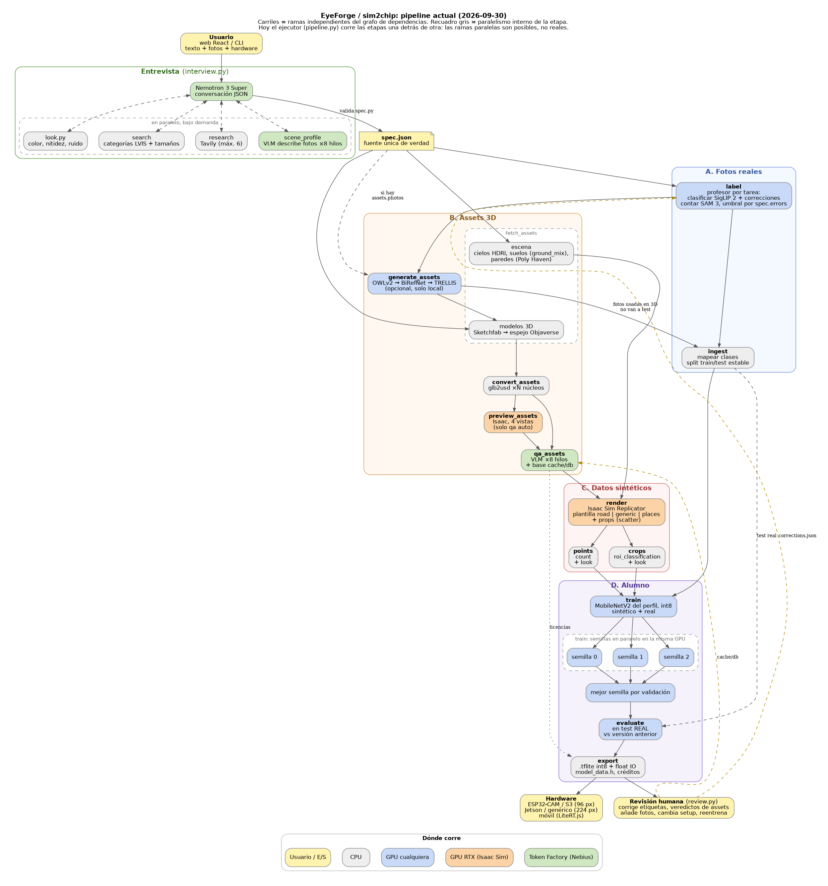

# Esquema del pipeline (estado del código a 2026-09-30)

Foto del pipeline tal como está implementado en `sim2chip/`, para revisarlo. El detalle de diseño está en `docs/architecture.md` y las tareas en `TODO.md`.



Imagen generada desde `esquema_pipeline.dot` (Graphviz): `dot -Tpng -Gdpi=110 docs/esquema_pipeline.dot -o docs/esquema_pipeline.png`.

## 1. Vista general

```
                USUARIO (web React en web/  o  CLI sim2chip)
                        │ texto + fotos (crudas o etiquetadas) + hardware
                        ▼
 ┌──────────────── ENTREVISTA (interview.py, Nemotron 3 Super en Token Factory) ───────────────┐
 │ acciones JSON: say | search (categorías Objaverse-LVIS y tamaños) | research (Tavily)        │
 │               | spec (se valida con spec.py; los errores vuelven al modelo)                  │
 │ ayudas: scene_profile.py (VLM describe las fotos -> scene.contexts, wall_tags, railings)     │
 │         look.py (mide color, nitidez y ruido de las fotos -> spec.look)                       │
 └──────────────────────────────────────────┬───────────────────────────────────────────────────┘
                                            ▼
                                   spec.json  (fuente única de verdad)
                                            │
                     sim2chip run spec.json --backend local | nebius
                                            ▼
             Pipeline (pipeline.py): etapas activas según el spec, huella por etapa,
             salta lo que ya está hecho y al día, --from / --only / --force
                                            │
            ┌───────────────────────────────┴───────────────────────────────┐
            ▼                                                               ▼
  LocalBackend (RTX 3090)                                  NebiusBackend (L40S, Serverless AI Job)
  subproceso por etapa con su intérprete:                  modo worker: 1 GPU pide todo el pipeline
  cpu/tf -> conda edge-sdg, isaac -> python.sh,            (cloud_worker.py), datos en Object Storage
  trellis -> env TRELLIS, SAM 3 -> SIM2CHIP_SAM3_PYTHON    (cloud_sync.py pull/push por etapa)
```

## 2. Etapas (orden de `sim2chip/stages/__init__.py`)

```
 FOTOS DEL USUARIO                       ASSETS 3D                                  ENTRENAMIENTO
 ─────────────────                       ─────────                                  ─────────────
 [label] SigLIP2/SAM3┬──> [generate_assets] TRELLIS (fotos -> 3D, opcional)
   (fotos crudas)    │            │
                     │            ▼
                     │     [fetch_assets] Sketchfab/Objaverse + Poly Haven (cielos, suelos, paredes)
                     │            ▼
                     │     [convert_assets] glb2usd: USD, enderezar, centrar, medir
                     │            ▼
                     │     [preview_assets] Isaac: 4 vistas por asset   (solo qa.mode=auto)
                     │            ▼
                     │     [qa_assets] VLM en Token Factory decide keep/discard y clase
                     │            ▼
                     │     [render] Isaac Sim Replicator: escenas desde el spec
                     │            ▼
                     │     ┌──────┴──────┐
                     │  [crops]      [points]          (según spec.task, con spec.look aplicado)
                     │  roi_class.   count
                     ▼     └──────┬──────┘
                 [ingest] ────────┼──────────────────────────────> [train] MobileNetV2 int8, 3 semillas
             train/test real      │                                   ▼
                                  └──────────────────────────────> [evaluate] en test REAL
                                                                      ▼
                                                                  [export] .tflite int8 + float IO,
                                                                  labels, model_data.h, report (licencias)
```

| Etapa | Qué hace | Runtime / GPU | Se activa si | Lee de |
|---|---|---|---|---|
| `label` | Etiqueta las fotos crudas. Clasificar: SigLIP 2, clase más cercana (descripción + fotos corregidas por el usuario), siempre una clase. Contar: SAM 3 con umbral según `spec.errors` y las correcciones. Respuestas en caché por foto | proceso aparte, GPU | `user_data.raw` | input/ |
| `generate_assets` | OWLv2 recorta, BiRefNet recorta fondo, TRELLIS v1 genera GLB. Caché por foto+query+semilla | trellis, GPU (solo local) | alguna clase con `assets.photos` | label |
| `ingest` | Normaliza, mapea clases, reparte train/test estable (`split.json`). Fotos usadas para 3D nunca van a test | cpu | hay fotos del usuario | label, generate_assets |
| `fetch_assets` | Busca y descarga modelos 3D (búsqueda en Sketchfab, descarga del espejo Objaverse), cielos y suelos (`ground_mix.py`) | cpu | alguna clase con assets | generate_assets |
| `convert_assets` | GLB a USD independiente de la clase (escala real se aplica en render) | cpu | ídem | fetch_assets |
| `preview_assets` | 4 vistas por asset sobre suelo neutro | isaac, RTX | `qa.mode=auto` | convert_assets |
| `qa_assets` | none / manual / auto (VLM "vision" o "describe_then_decide" con Nemotron). Veredictos a la base `cache/db` | cpu + Token Factory | alguna clase con assets | convert, preview |
| `render` | Plantilla de escena (`road`, `generic`, `places`) + props de fondo (`scatter`). Encuadre por tamaño real y `target_fill` | isaac, RTX | ídem | qa_assets, fetch_assets |
| `crops` | Recortes de la ROI a la entrada del modelo; fondos con cajas "robadas" de los targets | cpu | `task=roi_classification` | render |
| `points` | Frames completos con el centro de cada target visible | cpu | `task=count` | render |
| `train` | Backbone del perfil de hardware, preentrenado ImageNet, int8. Val = 10% de la mezcla; el test real nunca se usa | tf, GPU | siempre | crops, points, ingest |
| `evaluate` | Accuracy (o F1 de puntos y error de conteo) en test real; compara con la versión anterior | tf | hay fotos de test | train, ingest |
| `export` | Mejor semilla por validación. int8 + float IO (batch fijo 1), `model_data.h` para TFLite Micro, créditos CC-BY | cpu | siempre | train, evaluate, qa_assets |

## 3. Bucle de revisión humana (después de cada ejecución)

```
 Job terminado ──> página del job (web) ──> review.py muestra:
                    - fotos con la etiqueta del profesor   -> input/corrections.json -> rerun desde label
                    - assets con su veredicto de QA        -> cache/db (judge "user", sirve a futuros jobs)
                    - frames sintéticos al azar, predicciones en test
                    - "Make it better": añadir fotos (/photos), cambiar el setup (/revise), reentrenar (/train)
                  versions/v<n>/ guarda los modelos anteriores para compararlos en evaluate
```

## 4. Qué modelo hace cada cosa

| Papel | Modelo | Dónde |
|---|---|---|
| Entrevista | Nemotron 3 Super (preferencia `text` en `llm.py`) | Token Factory |
| Investigación en entrevista | Tavily (máx. 6 búsquedas) | API Tavily (falta la clave) |
| Profesor de etiquetado | SigLIP 2 (Google) para clasificar, SAM 3 (Meta) para contar | GPU local (en Nebius falta imagen propia con los pesos) |
| QA de assets y perfil de escena | GLM-5.3-Flash, MiniCPM-V (ningún Nemotron acepta imágenes) | Token Factory |
| Imagen a 3D | OWLv2 + BiRefNet + TRELLIS v1 | GPU local |
| Render | Isaac Sim 5.1 Replicator | RTX 3090 / L40S |
| Alumno | MobileNetV2 int8 (TFLite / TFLite Micro) | GPU local / L40S |

Perfiles de hardware (`hardware.py`): `esp32cam` y `esp32s3` (96 px, alpha 0.35, TFLite Micro), `jetson_nano` y `generic` (224 px, alpha 1.0, TFLite).

## 5. Almacenamiento

```
data/ (-> SSD Crucial)
  jobs/<job>/spec.json, input/, logs/, <etapa>/..., <etapa>/_done.json, versions/v<n>/
  cache/objaverse, usd/{glb2usd,raw,norm}, hdri, textures, generated/   (desechable)
  cache/db/reviews/*.jsonl        base de conocimiento de assets (conservar)
  cache/labels/<prompt>/<modelo>/<foto>.json   respuestas del profesor
Nebius: bucket por job s3://<prefix>-<job> + bucket compartido s3://<prefix>-cache
```

## 6. Fuera del pipeline principal

- `sim2chip match` (`match.py`): bucle LLM de escenas (Kimi compara, Nemotron Ultra ajusta palancas, KID acepta). **Aparcado** el 2026-09-29 por malos resultados. Se conserva la parte del look de cámara.
- Siguiente paso acordado (sin empezar, a la espera del visto bueno): geometría de cámara desde una foto (MoGe o Depth Anything + RANSAC) y foto real rectificada como suelo en Isaac. Ver `docs/plan_match.md`.
- Tareas ofrecidas hoy (`spec.TASKS`): `roi_classification` y `count`. El catálogo completo está en `docs/tipos_de_modelo.md`.

## 7. Puntos para revisar

- En `label` y `generate_assets` Nebius aún no puede correr SAM 3 ni TRELLIS: una ejecución 100% Nebius con fotos crudas se para antes de pedir GPU.
- `render` solo tiene tres plantillas. Lo específico de cada escena (balcones, césped) vive en ellas y en el spec, no en pasos al vuelo.
- La entrevista es la única entrada del spec. Lo que no pregunte, el pipeline no lo sabe (salvo `scene_profile` y `look`).
- `evaluate` depende de tener suficientes fotos de test reales (aviso en el log si hay menos de MIN_TEST).
